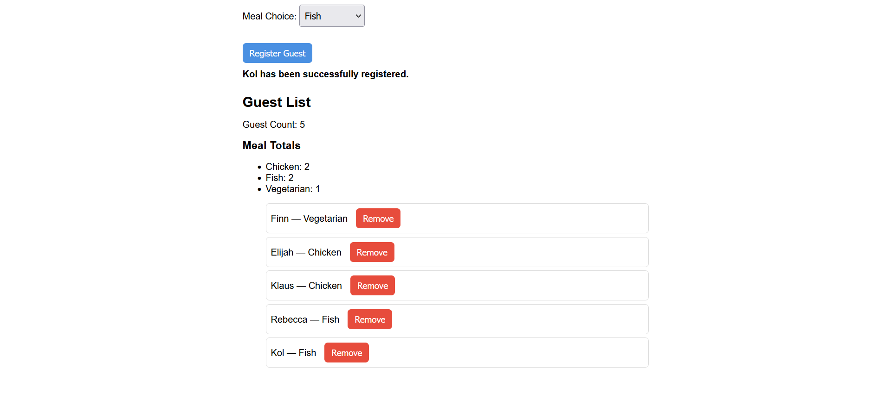

# Web Development Practice

Smaller projects and exercises from my web development studies. Each folder stands on its own. For larger projects, see my other repositories: **PropTrack** (Angular), **Team Hub** (React), **GitHub User Explorer** (React hooks) and **Inventory Tracker** (TypeScript).

| Folder | Tech | What it shows |
|---|---|---|
| [`async-javascript`](async-javascript) | JavaScript, Fetch API | `async`/`await`, Promises, `Promise.all` for parallel requests, loading and error states, and notes on the event loop |
| [`jquery-guest-registration`](jquery-guest-registration) | jQuery, HTML, CSS | Event guest registration with live preview, duplicate checking, meal totals and AJAX loading of a text file |
| [`xml-schema`](xml-schema) | XML Schema (XSD) | A schema for a product catalogue with required and optional attributes, enumerations and occurrence rules |
| [`angular-homes-app`](angular-homes-app) | Angular, TypeScript | A housing listings app built by following the official Angular tutorial |

## async-javascript

Open `index.html` in a browser and click **Load Users, Posts, Comments**. Three requests to the [JSONPlaceholder](https://jsonplaceholder.typicode.com/) test API run at the same time with `Promise.all`, and the results only appear once all three have finished. `script.js` also holds commented-out practice snippets: a reusable fetch function, two common `await` mistakes and their fixes, an event-loop ordering example, and a random joke loader.

## jquery-guest-registration

A guest sign-up page for an event, built with jQuery:

- `$(document).ready()` setup and `.on("click")` / `.on("keyup")` event handlers
- Live "Registering: …" preview as you type
- Validation against empty names and duplicate guests
- Running guest count and meal-choice totals
- `$.get()` to load `announcement.txt` into the page

Because of the AJAX request, run it through a local server rather than opening the file directly, for example with the VS Code Live Server extension or `npx serve`.

## xml-schema

`product-catalog.xsd` defines a `CATALOG` of `PRODUCT` elements. Each product has required `NAME` and `PARTNUM` attributes, optional `CATEGORY` and `PLANT` attributes restricted to fixed lists of values, and child elements with minimum and maximum occurrence rules.
